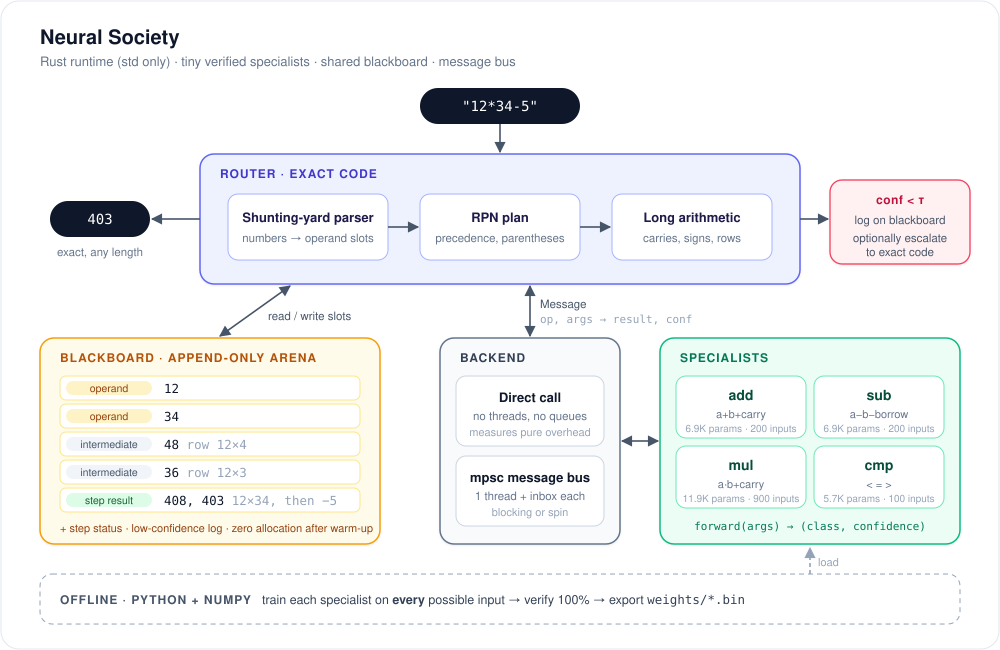

<div align="center">

# Neural Society

**Many tiny, verifiable specialist models, coordinated through a shared blackboard and a message bus.**

[](https://github.com/MikeS071/Neural-Society/actions/workflows/ci.yml)
[](LICENSE)


[How it works](#how-it-works) · [Results](#results) · [Quickstart](#quickstart) · [Architecture](neural-society/docs/ARCHITECTURE.md) · [Full write-up](neural-society/RESULTS.md)

</div>

---

Neural Society tests a simple question: **can a society of single-skill models do a
task that is harder than any one of them?** The first testbed is exact arithmetic on
expressions of any length, where every answer can be checked against Python big ints.

Instead of one network that has to learn arithmetic end to end, there are four
networks of 6–12K parameters each. Each one learns a single digit-level fact, such as
"add two digits and a carry", and is **checked against every possible input**. A
planner written in exact code composes them into long addition, subtraction and
multiplication.

<p align="center">
  
</p>

## Highlights

- 🔍 **Verified, not estimated.** Every specialist is 100% correct on its *entire*
  input space (200–900 cases), and the Rust runtime re-checks this on every CI run.
- 📏 **Works at any length.** The 31K-parameter society solves 30-digit, 5-operator
  expressions. A monolithic network 100x its size cannot even accept them.
- 🛟 **It catches its own mistakes.** Softmax confidence flags all of a weak
  specialist's errors. Escalating those answers to exact code restores 100%
  accuracy.
- ⚡ **Microsecond inference, no Python.** The runtime is std-only Rust with
  zero-allocation inference and a 20-byte `Copy` message.
- 🔁 **Any part can be swapped.** Learned and exact-code specialists share one trait,
  so an ablation is a config string: `learned,mul=weak` or `exact,add=learned`.

## How it works

1. **Parse.** The router, which is ordinary exact code, parses the expression with a
   shunting-yard pass. Each number goes onto the **blackboard** as a digit vector,
   and the result is an RPN plan.
2. **Orchestrate.** For each operator the router runs a schoolbook algorithm. Every
   time it needs an arithmetic fact, such as *what is 7×8 plus a carry of 3?*, it
   sends a fixed-size `Message` to the relevant **specialist** and gets back
   `(class, confidence)`.
3. **Specialists answer.** Each specialist is a tiny MLP that has seen every possible
   question it can be asked during training. It can be swapped for one line of exact
   code without the router noticing.
4. **Supervise.** If a reply's confidence falls below a threshold, the router logs it
   on the blackboard. With `--escalate` it also re-asks the exact-code version.
5. **Answer.** The final slot on the blackboard is the result. The rest of the
   blackboard is a complete, inspectable trace: operands, every multiplication row,
   every partial sum.

The **backend** decides how a message travels. `Direct` is a function call. `Bus`
gives each specialist its own thread and `mpsc` inbox, with blocking or spin
receives, and many routers can share it.

<details>
<summary><b>Example trace: <code>12*34</code> in 6 messages</b></summary>

```text
$ ns eval --threshold 1.01 "12*34"      # threshold > 1 logs every reply (output annotated)
408
society=learned messages=6 escalations=0 slots=5 arena_digits=11
  call #1 mul [2, 4, 0] -> 8  (conf 0.999)   row 0: 12 x 4
  call #2 mul [1, 4, 0] -> 4  (conf 0.999)          = 48
  call #3 mul [2, 3, 0] -> 6  (conf 1.000)   row 1: 12 x 3
  call #4 mul [1, 3, 0] -> 3  (conf 1.000)          = 36
  call #5 add [4, 6, 0] -> 10 (conf 1.000)   48 + 360: digit 0, carry 1
  call #6 add [0, 3, 1] -> 4  (conf 1.000)   -> 408
```

The sequence diagram for this run is in [ARCHITECTURE.md](neural-society/docs/ARCHITECTURE.md#walkthrough-1234).

</details>

## Results

Test set: 2,000 random expressions with 1–30-digit operands and 1–5 operators, plus
3,000 `a op b` problems with 3-digit operands for the baseline. Full tables and
discussion are in **[RESULTS.md](neural-society/RESULTS.md)**.

| system | params | 3-digit `a op b` | 3-digit `×` only | 1–30 digits, 1–5 ops |
|---|---:|---:|---:|---:|
| Monolithic MLP, 1x | 31.6K | 48.9% | 0.3% | cannot accept input |
| Monolithic MLP, 10x | 315K | 65.2% | 1.5% | cannot accept input |
| Monolithic MLP, 100x | 3.15M | 66.8% | 4.3% | cannot accept input |
| **Society, learned specialists** | **31.5K** | **100%** | **100%** | **100%** |
| Society, with a 96%-accurate `mul` | 31.5K | 95.4% | 86.6% | 60.9% |
| … plus confidence escalation (τ = 0.7) | 31.5K | 100% | 100% | 100% |

| mode (single router) | cost per digit operation | 30-digit expression |
|---|---:|---:|
| exact code, direct call | 8 ns | 18 µs |
| learned MLP, direct call | 1.3 µs | 3.1 ms |
| learned MLP, threaded bus, spin | 2.0 µs | 4.9 ms |
| learned MLP, threaded bus, blocking | 31 µs | 73 ms |

> [!IMPORTANT]
> **Read the results honestly.** The ability to handle any length comes from the
> hand-written router (long multiplication, carries, signs), not from learning. The
> specialists are learned lookup tables of at most 900 entries. At this granularity a
> message bus costs far more than the work each message carries, and carry chains
> leave nothing to run in parallel. Whether a *learned* planner can replace the router
> is the real open question. [RESULTS.md](neural-society/RESULTS.md#honest-read)
> sets out where the approach wins and where it doesn't.

## Quickstart

**Requirements:** Rust 1.70+ (stable). Python 3.9+ with NumPy, only if you want to
retrain.

```bash
git clone https://github.com/MikeS071/Neural-Society.git
cd Neural-Society/neural-society/runtime

cargo build --release
cargo test --release

# Evaluate an expression with the learned society (weights are committed)
cargo run --release -- eval "123456789012345678901234567890*987654321098765432109876543210"

# Swap in the weak multiplier, then let confidence escalation repair it
cargo run --release -- eval --society learned,mul=weak "999*999*999"
cargo run --release -- eval --society learned,mul=weak --escalate "999*999*999"

# Route every digit question over the threaded message bus
cargo run --release -- eval --bus --spin "2-3-4*5*6+7"
```

### CLI reference

| command | description |
|---|---|
| `ns eval EXPR` | Evaluate `+ - *` and parentheses on non-negative integers of any length. |
| `ns verify` | Run every specialist on its whole input space; calibrate `mul_weak`'s confidence. |
| `ns bench [--quick]` | Full benchmark suite; writes `results/bench.md`. |

| flag | meaning |
|---|---|
| `--society CFG` | `learned` (default), `exact`, or per-op overrides such as `learned,mul=weak` or `exact,add=learned` |
| `--bus` / `--spin` | use the threaded message bus / busy-poll before blocking |
| `--threshold T` | log replies with confidence below `T` (default 0.9) |
| `--escalate` | replace low-confidence replies with the exact-code answer |
| `--weights DIR`, `--data DIR` | override the default `../weights` and `../data` paths |

### Reproduce everything

```bash
cd neural-society/train
pip install numpy
python3 specialists.py   # ~8 s: add, sub, mul, cmp (100%) and mul_weak (96%)
python3 baseline.py      # ~15 min on 4 cores: monolithic MLP at 1x/10x/100x (--quick: 1 min)
python3 gen_tests.py     # benchmark expressions with big-int ground truth

cd ../runtime
cargo run --release -- bench   # ~2 min; writes ../results/bench.md
```

## Repository layout

```text
neural-society/
├── train/                 Python + NumPy (training only)
│   ├── nn.py              MLP with manual backprop, Adam, NSOC binary export
│   ├── specialists.py     add / sub / mul / cmp, trained and verified on every input
│   ├── baseline.py        monolithic `a op b` MLP at three parameter budgets
│   └── gen_tests.py       benchmark expressions + ground truth
├── runtime/               Rust, std only; no Python at runtime
│   └── src/
│       ├── model.rs       NSOC loader, MLP forward pass, softmax confidence
│       ├── specialists.rs Specialist trait; Learned and Exact implementations
│       ├── bus.rs         20-byte Message, mpsc bus (blocking/spin), Direct backend
│       ├── blackboard.rs  preallocated append-only arena of typed digit slots
│       ├── router.rs      shunting-yard planner + digit-by-digit long arithmetic
│       ├── baseline.rs    the monolithic baseline, run from Rust
│       └── main.rs        `ns` CLI: eval / verify / bench
├── weights/               exported models + training reports
├── data/                  benchmark expressions (TSV)
├── results/bench.md       raw benchmark output
├── fixloop/               milestone 2: fix-the-failing-test (planner + specialists)
├── docs/ARCHITECTURE.md   component design, message flow, trade-offs
├── RESULTS.md             findings and honest read
└── HANDOVER.md            original project brief
```

## Roadmap

- [x] Exhaustively verified digit specialists (`add`, `sub`, `mul`, `cmp`)
- [x] Rust runtime: model loader, blackboard, message bus, router, direct-call mode
- [x] Monolithic baseline at 1x / 10x / 100x parameters
- [x] Benchmarks: accuracy by length, error compounding, latency, throughput
- [x] Confidence-based escalation to exact code
- [ ] Batched messages (a whole multiplication row per message) to amortise bus cost
- [ ] Tiny transformer specialists (llama2.c-style), same binary export
- [ ] A learned planner in place of the hand-written router
- [x] **Milestone 2 harness:** a "fix the failing test" loop with a large-model planner,
      alone vs. with compiler / linter / test-runner / localizer / learned
      failure-classifier specialists on a blackboard ([`fixloop/`](neural-society/fixloop/README.md))
- [x] **Milestone 2 results, local 4B planner** (Qwen3.5-4B, CPU, thinking off and on):
      the society arm is cheaper when both arms succeed but solves fewer tasks
      (24/31 vs 28/31 thinking off). See [`fixloop/RESULTS.md`](neural-society/fixloop/RESULTS.md)
- [ ] Milestone 2 follow-ups: society + test-files ablation, `--repeats 3`, 1.7B / 9B
      local models, and Claude models (needs an Anthropic API key)

## License

[MIT](LICENSE) © 2026 MikeS071
