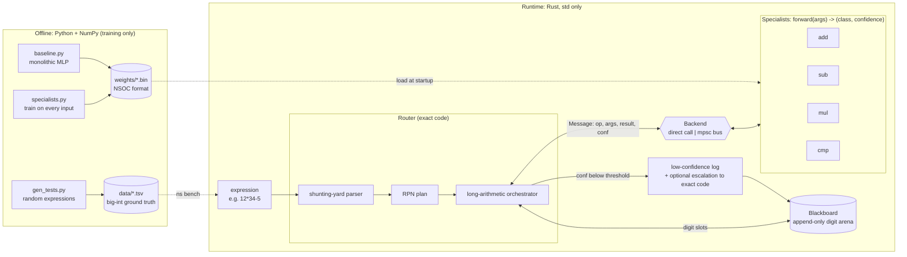
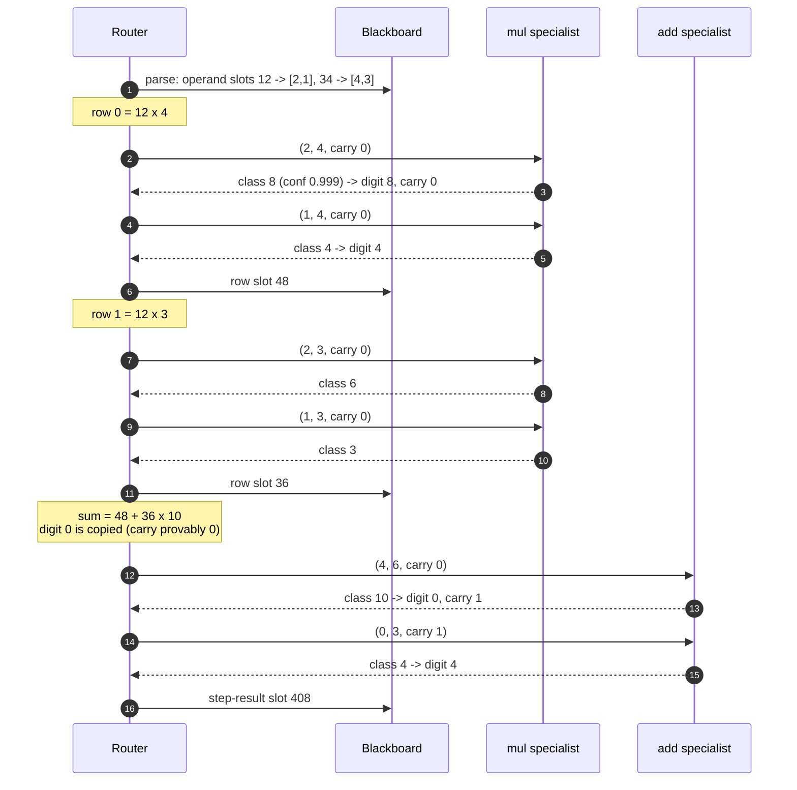

# Architecture

This document explains how a Neural Society evaluates an expression. Measurements are
in [`RESULTS.md`](../RESULTS.md).

## The idea in one paragraph

Arithmetic on long numbers is a few tiny, closed skills applied over and over:
"add two digits and a carry", "multiply two digits and add a carry", "which digit
is bigger". Each of those skills has a finite input space, at most 900 cases, so a
small neural network can learn it and then be **checked against every possible
input**. A *specialist* is trained for each skill. An exact-code *router* plans the
work and asks the specialists one digit-level question at a time. Every
intermediate value lives on a shared *blackboard*. The router can talk to the
specialists through plain function calls or through a *message bus* where each
specialist runs on its own thread. Because specialists sit behind one trait, any of
them can be swapped for exact code or a weaker model, which makes ablations a
config string.

## System overview



## Components

### Specialists (`runtime/src/specialists.rs`)

| op | inputs (one-hot fields) | output class | used for |
|---|---|---|---|
| `add` | a 0-9, b 0-9, carry 0-1 | a+b+c (0-19) | long addition; accumulating multiplication rows |
| `sub` | a 0-9, b 0-9, borrow 0-1 | a-b-borrow+10 (0-19) | long subtraction |
| `mul` | a 0-9, b 0-9, carry 0-8 | a·b+c (0-89) | one row of long multiplication |
| `cmp` | a 0-9, b 0-9 | `<` `=` `>` | deciding the sign of a difference |

Every specialist implements one trait:

```rust
pub trait Specialist: Send {
    fn op(&self) -> Op;
    fn kind(&self) -> &str;
    fn forward(&mut self, args: [u8; 4]) -> (u16, f32); // (class, confidence)
}
```

- **`Learned`** wraps an MLP. The one-hot input is never materialised. The first
  layer's weights are stored transposed, so the first layer is the bias plus 2 or 3
  contiguous weight rows. Confidence is the softmax probability of the argmax
  class.
- **`Exact`** is the same operation written as one line of code, with confidence
  1.0.
- `build_society("learned,mul=weak")` chooses an implementation per op. That is the
  whole ablation mechanism.

Each class output is chosen so that the next step's input is always in range. For
example, `mul`'s class is at most 9·9+8 = 89, so the carry `class / 10` is at most 8,
which is exactly `mul`'s carry field. Even a wrong specialist can never feed the
router an out-of-range value.

### Model runtime (`runtime/src/model.rs`)

`model.rs` loads the `NSOC` binary format written by `train/nn.py`:

```
b"NSOC" | u32 n_layers | per layer: u32 in, u32 out, f32[out*in] W (row-major), f32[out] b
```

The forward pass is plain Rust. Hidden layers use ReLU, and dot products use eight
accumulators so the compiler can vectorise them. Activations go into a preallocated
`Scratch`, so inference never allocates.

### Router / planner (`runtime/src/router.rs`)

1. **Parse.** A shunting-yard pass tokenises the string, writes each number onto the
   blackboard as an operand slot, and emits an RPN plan that respects `*` over `+ -`
   precedence and parentheses.
2. **Execute the plan.** For each operator it takes two slots from the stack and
   writes a result slot:
   - **`+` and `-`** are turned into signed addition. With equal signs it adds the
     magnitudes. With different signs it asks `cmp` which magnitude is larger
     (lengths are compared structurally first), then asks `sub` to take the smaller
     from the larger.
   - **`*`** is long multiplication. One row per digit of the shorter operand is
     built with `mul` plus carry, and each row is added, shifted, into a running sum
     with `add`. The result's sign is the XOR of the operand signs.
3. **Ask.** Every digit-level question goes through `ask()`. It counts the call and
   logs any reply below the confidence threshold to the blackboard. With
   `--escalate` it also replaces such replies with the exact answer.

Split of responsibilities: the router does only structural work. That means
indexing digits, splitting a class into `digit = class % 10` and `carry = class / 10`,
comparing lengths, XOR-ing signs, and copying digits below a shift, where the carry
is provably 0. Every arithmetic fact comes from a specialist.

### Blackboard (`runtime/src/blackboard.rs`)

The blackboard is one `Vec<u8>` of digits, least significant first, plus a table of
slots:

```rust
struct Slot { kind: Operand | Intermediate | StepResult, status: Pending | Done, neg: bool, start: u32, len: u32 }
```

The arena is **append-only**: only the newest slot is writable, so writing a result
never moves the operands it reads. `reset()` clears it but keeps the capacity, so
steady-state evaluation does no heap allocation. After an evaluation the blackboard
holds the complete trace: operands, every multiplication row, every partial sum, the
step results and the low-confidence log.

### Message bus (`runtime/src/bus.rs`)

```rust
#[repr(C)]
struct Message { id: u32, from: u16, to: u16, op: u8, args: [u8; 4], result: u16, conf: f32 } // 20 bytes, Copy
```

The router talks to a `Backend`. There are two implementations:

| backend | how a question is answered | when to use |
|---|---|---|
| `Direct` | a function call into the specialist | measuring pure orchestration cost |
| `Bus` / `BusClient` | `send` to the specialist's `mpsc` inbox; the specialist thread replies on the client's reply channel | many routers sharing specialists; isolation |

The bus has two receive modes. *Blocking* parks the thread on every receive.
*Spin-then-block* busy-polls with `try_recv`, yields periodically, and falls back to
blocking. Many routers can share one bus: `from` says which reply channel the
answer goes to.

## Walkthrough: `12*34`

The exact trace printed by `ns eval --threshold 1.01 "12*34"` (a threshold above 1
logs every reply):



The whole run is 6 messages, 5 slots and 11 digits in the arena. A 30-digit
expression with 5 operators takes about 2,400 messages.

## Design decisions and trade-offs

| decision | why | cost |
|---|---|---|
| Specialists see one digit position at a time | finite input space, so each one can be fully verified | message count grows as length² for multiplication |
| Exact-code router | correctness and unlimited length come for free | the planner is hand-written; this prototype does not test whether one can be learned |
| One trait for learned and exact | ablations are config strings; escalation is trivial | a dynamic dispatch per call (negligible next to a 1.3 µs MLP) |
| Append-only arena | no aliasing, no allocation, a full trace for free | memory grows with the trace (fine at this scale) |
| `std::sync::mpsc` bus | simple and std only | about 29 µs per message when blocking, about 0.7 µs when spinning; carry chains are serial, so threads add no parallelism within one expression |

The main lesson for the next milestone is to keep messages coarse. The bus pays off
when each message carries milliseconds of work (a compile, a test run) or when many
independent requests are in flight. It does not pay off for 8 ns digit operations.
