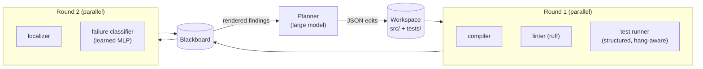

# Milestone 2: fix the failing test

Does a large model fix bugs better, faster or more cheaply when fast specialists feed it
structured findings through a blackboard, compared with the same model working from
raw tool output?

**Status:** the harness, task suite, specialists and both arms are built and tested
offline. No real model runs have been done yet. They need either an
`ANTHROPIC_API_KEY` or a locally hosted model (see [Running](#running)). Nothing in this folder reports model results until those runs
exist.

## The experiment

|  | **solo** (baseline) | **society** |
|---|---|---|
| Planner | Claude model *M* | the same model *M* |
| Each turn the planner sees | source files, test files, raw `python -m unittest -v` output | source files, rendered blackboard |
| Tools run between turns | the test command | compiler, linter, test runner (in parallel), then localizer and failure classifier |
| Edit format, iteration budget, success test | identical | identical |

**Success** means the visible suite passes *and* a hidden test suite passes, so a fix
that special-cases the visible tests does not count. Each run reports success, planner
calls (iterations), input and output tokens, LLM time and tool time.



## Specialists

Each specialist follows the same contract as the arithmetic specialists:
`run(workspace, blackboard) -> Report(data, confidence)`.

| specialist | what it writes to the blackboard | cost |
|---|---|---|
| `compiler` | syntax errors with file, line and code, checked in-process without running anything | ~1 ms |
| `linter` | ruff findings (pyflakes, syntax, a bugbear subset); undefined names show up here | ~20 ms |
| `tests` | each failing test with its exception, message, failing test line and innermost source frames. On a hang, `faulthandler` reports the line where execution was stuck | 50 ms – 5 s |
| `localizer` | ranks suspect functions using the source frames of the failures, the hang stack, compile errors, or the functions called on the failing test line; includes the top suspect's source with line numbers | ~1 ms |
| `classifier` | likely bug class (condition, arithmetic, value, wrong_name, missing_logic, syntax) with softmax confidence. A 2.3K-parameter MLP over 64 failure-signature features | ~1 ms |

The blackboard also tracks progress between rounds: which tests newly pass and which
regressed.

### Failure classifier

The classifier is trained only on **automatically generated** AST mutants of the
reference programs (`ns_fix/mutate.py`, 903 mutants that break a suite). It is never
trained on the hand-written evaluation bugs. `python3 train_classifier.py` rebuilds it
from scratch in about 80 s.

| evaluation | accuracy |
|---|---:|
| leave-one-program-out (mutants of an unseen program) | 64.5% |
| the 31 hand-written evaluation tasks | 41.9% (top-2: 64.5%) |
| chance (6 classes) | 16.7% |

It is a weak specialist. Mean confidence is 0.74 when it is right and 0.59 when it is
wrong, so the planner is told to treat outputs under 0.7 as a weak hint. Whether such a
hint helps or distracts the planner is one of the things the experiment measures.

## Task suite

There are 10 small reference programs in `programs/`: stats, text utilities, intervals,
roman numerals, an inventory class, binary search, matrices, dates, a ledger and graphs.
Each has visible tests and hidden tests. `tasks.json` injects **31 bugs** into them:

- every category: off-by-one, wrong comparison, wrong operator, wrong name, missing
  logic, wrong constant, syntax error;
- **3 two-bug tasks** (`stats-two-bugs`, `ledger-two-bugs`, `inventory-latent-delete`);
- **2 latent tasks**, where the second bug is only caught by the hidden tests;
- an **infinite loop** (`bsearch-hang`) and a non-terminating BFS (`graph-visited`);
- **bugs in helper functions**, where the failing test exercises a different function
  (`ledger-helper-pad`).

`python3 validate_tasks.py` checks that every reference program passes its suites and
that every bug breaks the visible suite.

## Running

```bash
cd neural-society/fixloop
python3 -m unittest discover -s tests          # offline harness tests (~40 s)
python3 run_bench.py --planner oracle           # harness check: a bug-reverting oracle, both arms

export ANTHROPIC_API_KEY=...                    # in a cloud session: set it in the environment settings
python3 run_bench.py --model claude-sonnet-5-5 --repeats 3
python3 run_bench.py --model claude-haiku-5-5 --repeats 3
```

Each run writes `results/<model>.json`, with every run and full transcripts, and
`results/<model>.md`, with summary and per-task tables.

### Local, CPU-only planner

`--planner local` drives any OpenAI-compatible server: Ollama, llama.cpp's
`llama-server`, LM Studio or vLLM. No API key is needed.

```bash
# Ollama
ollama pull qwen2.5-coder:7b
python3 run_bench.py --planner local --model qwen2.5-coder:7b --workers 1

# llama.cpp
llama-server -m qwen2.5-coder-7b-instruct-q4_k_m.gguf -c 16384 --port 8080
python3 run_bench.py --planner local --model local --base-url http://localhost:8080/v1 --workers 1
```

On CPU, use `--workers 1`, because generation is compute-bound and parallel requests
only queue. Allow on the order of 1–3 minutes per planner call for a 4-bit 7B model on
4 cores (an estimate, not yet measured here). A full pass of 62 runs could therefore
take several hours; 1.5B–3B models are several times faster. Small local models are
where structured specialist help is most likely to change the outcome.

There are no dependencies beyond the Python standard library. ruff is optional: without
it the linter reports itself unavailable. NumPy is needed only to retrain the
classifier.

## Design choices and threats to validity

- **Same information, different form.** Both arms always see the full source of
  `src/`. Solo also sees the test files; society sees the failing test lines instead.
  So the comparison is about structure and extra signals, not about hiding code from
  the baseline.
- **Multi-turn for both arms.** Each turn adds the new observation and any files that
  changed, so token counts grow the same way in both arms.
- **The tasks are small.** A strong model may solve nearly everything on the first try
  in both arms, which would itself be a finding. Running a smaller model (Haiku) is
  where structured help is most likely to show.
- **Classifier leakage.** The classifier was trained on mutants of the *same* ten
  programs, although never on the evaluation bugs. Its leave-one-program-out score is
  the honest number for unseen code.
- **Determinism.** The planner runs at temperature 0, but API outputs are still not
  bit-for-bit reproducible, so use `--repeats` for any claim.
